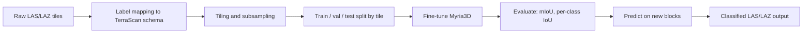

# LiDAR Point Cloud Classification (TerraScan Class Schema)


Semantic segmentation of airborne LiDAR point clouds into TerraScan-style classes, built by fine-tuning the open-source [Myria3D](https://github.com/IGNF/myria3d) framework.

## Table of Contents
- [Overview](#overview)
- [Motivation](#motivation)
- [Class Schema](#class-schema)
- [Pipeline](#pipeline)
- [What Is Reused vs. What Is Mine](#what-is-reused-vs-what-is-mine)
- [Data](#data)
- [Model and Training](#model-and-training)
- [Evaluation](#evaluation)
- [Results](#results)
- [Error Analysis and Limitations](#error-analysis-and-limitations)
- [Installation](#installation)
- [Usage](#usage)
- [Project Structure](#project-structure)
- [Roadmap](#roadmap)
- [Acknowledgements](#acknowledgements)
- [License](#license)
- [Author](#author)

## Overview

Classifying LiDAR point clouds by hand in tools like TerraScan is slow, repetitive, and expensive at survey scale. This project automates the first pass: a deep learning model predicts a class for every point (ground, vegetation, building, etc.), so human operators only need to review and correct instead of classifying from scratch.

The model is a fine-tuned Myria3D network, adapted to a **TerraScan-compatible class schema** instead of the default one.

## Motivation

- Classification is the most time-consuming step in LiDAR production workflows.
- Public pretrained models use class schemas that differ from the TerraScan classes used in production.
- This project explores how well a pretrained model transfers to a TerraScan-style schema with limited fine-tuning.

## Class Schema

| ID | Class | Description |
|---|---|---|
| [2] | Ground | [Bare earth] |
| [3] | Low vegetation | [e.g., < 0.5 m] |
| [4] | Medium vegetation | [e.g., 0.5 to 2 m] |
| [5] | High vegetation | [e.g., > 2 m] |
| [6] | Building | [Roofs and structures] |
| [..] | [Other classes] | [..] |

[Replace this table with the classes you actually train on. Note any classes you merged or dropped, and why.]

## Pipeline



## What Is Reused vs. What Is Mine

| Component | Source |
|---|---|
| Model architecture and base training framework | Myria3D (IGN), unchanged |
| Pretrained weights | [Myria3D release / your source] |
| Class mapping to TerraScan schema | Mine |
| Data preparation scripts | Mine |
| Training configs (Hydra) | Mine, based on Myria3D defaults |
| Evaluation and error analysis scripts | [Mine / adapted] |
| [Augmentation, class weighting, post-processing] | [Mine, if you did them] |

[Be exact here. Interviewers will ask what you changed versus the original, so only list what's true.]

## Data

- **Format:** [LAS / LAZ]
- **Source:** [Public dataset name and link, or describe it without naming a client]
- **Size:** [N tiles, ~X million points, area covered]
- **Point density:** [~X pts/m²]
- **Attributes used as input:** [XYZ, intensity, return number, number of returns, RGB, etc.]
- **Split:** [e.g., 70/15/15 by tile, no spatial overlap between splits]

**Preprocessing:**
1. [Label remapping to the TerraScan schema]
2. [Tiling into X m × X m patches]
3. [Subsampling to N points per sample]
4. [Label cleanup: removed noise or unclassified points]

> The dataset is **not included** in this repository. [State why, e.g., licensing or size.] See [Usage](#usage) for the expected folder layout.

## Model and Training

| Setting | Value |
|---|---|
| Base framework | Myria3D (PyTorch Lightning + Hydra) |
| Backbone | [Check the Myria3D docs for the architecture you used] |
| Starting weights | [Pretrained checkpoint / from scratch] |
| Input features | [XYZ + intensity + ...] |
| Loss | [Cross-entropy / weighted / focal] |
| Optimizer | [e.g., Adam, lr = X] |
| Batch size | [N] |
| Epochs | [N] |
| Hardware | [GPU model, VRAM] |
| Training time | [X hours] |

**Class imbalance:** [Describe how you handled it: class weights, resampling, or "not handled yet".]

## Evaluation

Metrics reported on the held-out test tiles:
- **Overall accuracy (OA)**
- **mIoU** (mean intersection over union across classes)
- **Per-class IoU, precision, and recall**
- **Confusion matrix** to see which classes get mistaken for each other

## Results

| Metric | Value |
|---|---|
| Overall accuracy | [XX.X %] |
| mIoU | [XX.X %] |

**Per-class results**

| Class | IoU | Precision | Recall |
|---|---|---|---|
| Ground | [ ] | [ ] | [ ] |
| Low vegetation | [ ] | [ ] | [ ] |
| Medium vegetation | [ ] | [ ] | [ ] |
| High vegetation | [ ] | [ ] | [ ] |
| Building | [ ] | [ ] | [ ] |


*Left: ground truth. Right: model prediction. [Add one line on what the image shows.]*


## Error Analysis and Limitations

[Write these from your real results. Examples of what to look for:]
- [Which classes are confused most (e.g., medium vs. high vegetation)?]
- [Where does it fail: tile edges, dense urban areas, steep terrain, bridges, water?]
- [Does performance drop on a different area or sensor than the training data?]
- [Known limits: small dataset, few samples for rare classes, single region.]

## Installation

```bash
git clone https://github.com/mr-liki/lidar-terrascan-classification.git
cd lidar-terrascan-classification

python -m venv venv
venv\Scripts\activate          # Windows
# source venv/bin/activate     # Linux / macOS

pip install -r requirements.txt
```

**Requirements:** Python [3.10+], PyTorch [version] with CUDA [version], [list any system libraries].

## Usage

**1. Prepare the data**
```bash
python scripts/prepare_data.py --input data/raw --output data/processed
```

**2. Fine-tune**
```bash
python run.py --config-name [your_train_config]
```

**3. Evaluate**
```bash
python scripts/evaluate.py --checkpoint [path/to/checkpoint.ckpt] --data data/processed/test
```

**4. Predict on a new block**
```bash
python scripts/predict.py --input [block.laz] --output [block_classified.laz]
```

**Expected data layout**
```
data/
├── raw/          # original LAS/LAZ files
└── processed/
    ├── train/
    ├── val/
    └── test/
```

[Replace every command with the exact one that works on your setup, and test it on a clean clone.]

## Project Structure

```
.
├── configs/          # Hydra configs (training, data, class mapping)
├── scripts/          # Data prep, evaluation, prediction
├── docs/             # Images and notes
├── requirements.txt
├── LICENSE
└── README.md
```

## Roadmap

- [x] Fine-tune Myria3D on the TerraScan class schema
- [ ] Improve the weakest classes ([list them])
- [ ] Add class balancing / augmentation experiments
- [ ] Full-block inference script with tile stitching
- [ ] Reimplement the architecture from scratch to understand and customize it
- [ ] Compare against a second baseline model

## Acknowledgements

This project builds on [Myria3D](https://github.com/IGNF/myria3d) by IGN (Institut National de l'Information Géographique et Forestière), licensed under BSD-3-Clause. The fine-tuning setup, data preparation, and TerraScan class mapping are my own work.

If you use Myria3D in research, please cite it as described in its repository.

## License

BSD 3-Clause License. See [LICENSE](LICENSE).

## Author

**Likhith R**
GitHub: [mr-liki](https://github.com/mr-liki) · LinkedIn: [your URL] · Email: [your email]
